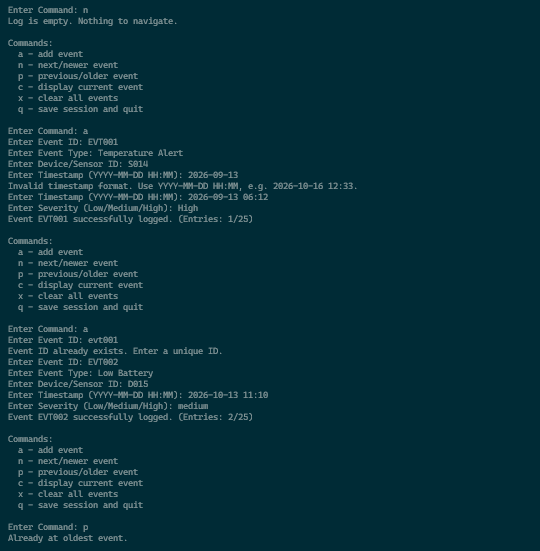
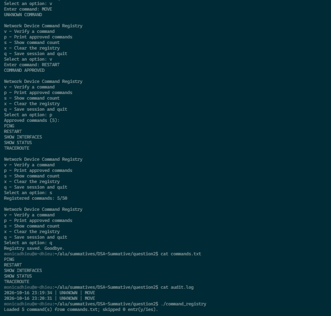
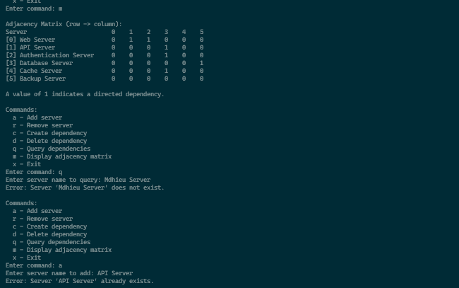
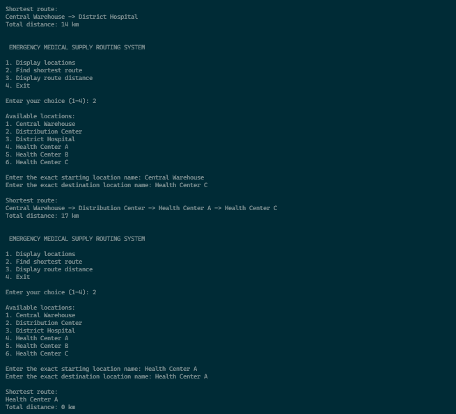
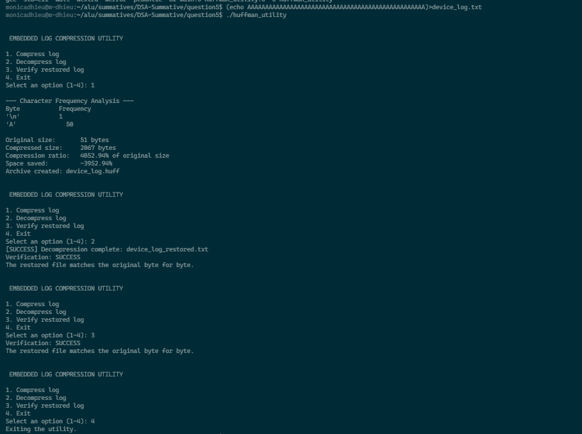
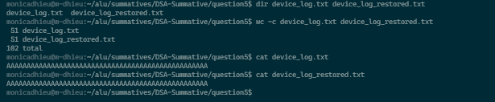

# DSA In C

This report presents five C programming solutions covering embedded device event logging using doubly linked lists, network device command management using binary search trees, server dependency analysis using directed graphs, emergency medical supply routing using Dijkstra’s shortest-path algorithm, and embedded firmware log compression using Huffman coding.

---

## Repository Structure

```
.
├── LICENSE
├── .gitignore
├── README.md				
├── question1/                          # Embedded Device Event Logger
├── question2/                          # Network Device Command Registry
├── question3/                          # Server Dependency Network Analyzer
├── question4/                          # Emergency Medical Supply Routing System
└── question5/                          # Embedded Firmware Log Compression Utility
```

---

## Compilation & Execution

### Question 1
```bash
cd question1
make clean
make
./event_logger
```

### Question 2
```bash
cd question2
make clean
make
./command_registry
```

### Question 3
```bash
cd question3
make clean
./net_analyser
```

### Question 4
```bash
cd question4
make clean
make
./routing_program
```

### Question 5
```bash
cd question5
make clean
make
./huffman_utility
```

---

## Summary of Projects

### Question 1: Embedded Device Event Logger
* This application records, manages, navigates, and saves diagnostic events generated by embedded monitoring devices. It uses dynamically allocated doubly linked list to manage event records.
* **Detailed Explanation:**
  [Question 1](question1/README.md)
* **Execution Verification:**
  

### Question 2: Network Device Command Registry
* This application stores, searches, displays, counts, and manages network device commands using a Binary search tree (BST).
* **Detailed Explanation:**
  [Question 2](question2/README.md)
* **Execution Verification:**
  

### Question 3: Server Dependency Network Analyzer
* This application models relationships between servers in a computer network. It represents servers as vertices and directed dependencies as edges.
* **Detailed Explanation:**
  [Question 3](question3/README.md)
* **Execution Verification:**
  

### Question 4: Emergency Medical Supply Routing System
* This application calculates the shortest route between medical facilities and supply locations. It models the locations as vertices and the distances between them as weighted edges.
* **Detailed Explanation:**
  [Question 4](question4/README.md)
* **Execution Verification:**
  

### Question 5: Embedded Firmware Log Compression Utility
* This application compresses/decompresses device log files using Huffman coding.
* **Detailed Explanation:**
  [Question 5](question5/README.md)
* **Execution Verification:**
  
  

---

## AI Assistance Used

AI tools were used to support:

- Debugging and troubleshooting implementation issues.
- Improving documentation structure and clarity.

---

## Resources

The following resources were used for learning and reference during the development of these projects:

- [Abdul Bari DSA (YouTube)](https://www.youtube.com/playlist?list=PLsr8vTgyLdy_YndxNcI4WkH5Vorj5qvrv)
- [GeeksforGeeks Learn DSA in C](https://www.geeksforgeeks.org/c/learn-dsa-in-c/)
- [Opencourseware C Best Practices](https://ocw.mit.edu/courses/6-087-practical-programming-in-c-january-iap-2010/)

---

## License

This project is under the MIT License.

---

## Author

Monica Dhieu

---

*Friday, October 16, 2026*


